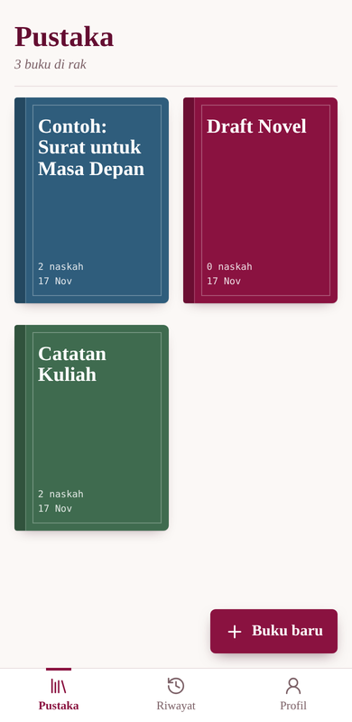
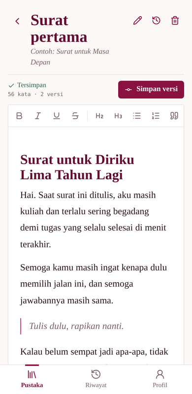
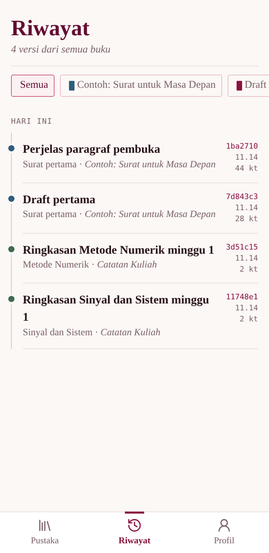
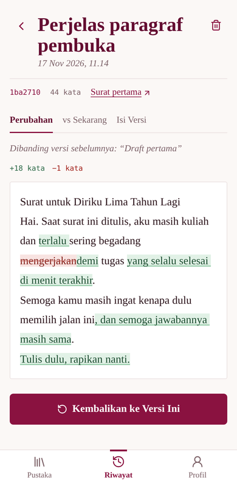
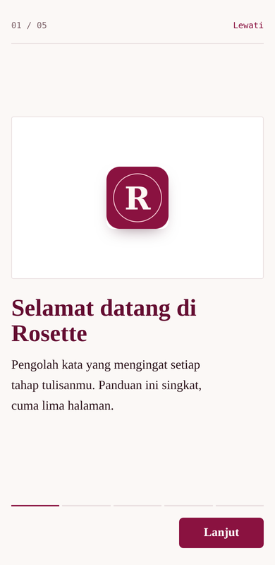
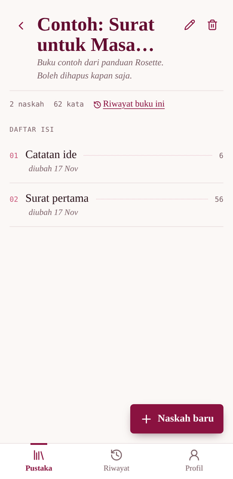
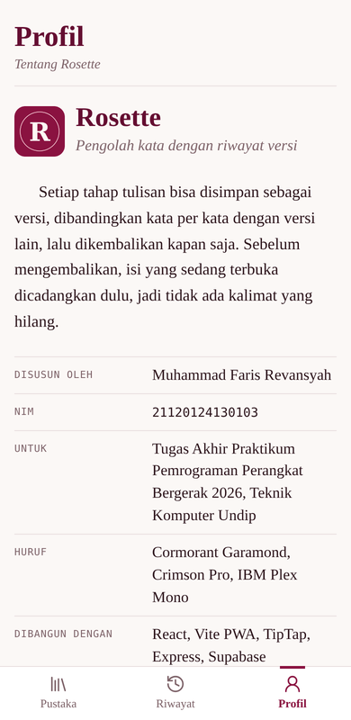

# Rosette: Word Processor Control Version App

Tugas Akhir Praktikum Pemrograman Perangkat Bergerak 2026 · **Progressive Web App**
Muhammad Faris Revansyah · 21120124130103 · Teknik Komputer, Universitas Diponegoro

**Aplikasi:** https://rosette-ppb-su2m.vercel.app
**API:** Express + Supabase, di-deploy terpisah di Vercel (lihat [`api/README.md`](api/README.md))

Rosette adalah pengolah kata yang menyimpan setiap tahap tulisan sebagai **versi**.
Versi bisa dibandingkan kata per kata dan dikembalikan kapan saja. Sebelum
mengembalikan, isi yang sedang terbuka dicadangkan otomatis, jadi tidak ada tulisan yang hilang.

<p>
  
  
  
  
</p>

## Fitur

- **Buku dan naskah:** buku adalah wadah naskah. Buat, ubah, hapus, dan beri warna sampul.
- **Editor teks kaya (TipTap):** tebal, miring, garis bawah, coret, judul, daftar, kutipan, undo/redo.
- **Autosave:** naskah tersimpan otomatis setelah berhenti mengetik.
- **Offline-first:** saat internet putus, tulisan disimpan di perangkat dan disinkronkan saat online lagi.
- **Simpan versi (snapshot):** salinan naskah pada satu titik waktu, lengkap dengan pesan.
- **Diff kata per kata:** bandingkan versi dengan versi sebelumnya atau dengan isi saat ini.
- **Restore aman:** kembalikan naskah ke versi mana pun, isi sekarang dicadangkan otomatis.
- **Riwayat per buku:** filter per buku, dikelompokkan per naskah, ditandai warna sampul.
- **Panduan pembuka** dengan opsi membuat buku contoh.
- **Installable:** bisa dipasang ke layar utama HP dan berjalan tanpa address bar.

## Pemenuhan ketentuan TA

| Ketentuan | Implementasi |
|---|---|
| API buatan sendiri sesuai Modul 1 | `api/`: Node.js + Express + Supabase, pola config → models → controllers → routes, `.env`, deploy Vercel |
| Bottom Navigation Bar | Pustaka · Riwayat · Profil |
| Minimal 5 halaman | 7 halaman: Panduan, Pustaka, Detail Buku, Editor, Riwayat, Detail Versi, Profil |
| 2 halaman utama berisi list → detail | **Pustaka** → Detail Buku → Editor, **Riwayat** → Detail Versi |
| Halaman Profile/About | **Profil** (tentang aplikasi dan pengembang) |
| PWA di-deploy ke free hosting | Vercel: https://rosette-ppb-su2m.vercel.app |

## Halaman

| | | | |
|---|---|---|---|
|  |  |  |  |
| Panduan | Pustaka (list #1) | Detail Buku | Editor |
|  |  |  | |
| Riwayat (list #2) | Detail Versi | Profil | |

## Teknologi

| Bagian | Stack |
|---|---|
| Frontend | React 19, Vite, vite-plugin-pwa (Workbox), React Router, TipTap, jsdiff, lucide-react |
| Backend | Node.js, Express 5, @supabase/supabase-js |
| Database | Supabase (PostgreSQL): tabel `books`, `documents`, `snapshots` |
| Hosting | Vercel (dua project: `api` dan `web`) |

## Struktur

```
rosette-ppb/
├── api/                 REST API (pola Modul 1)
│   ├── schema.sql       skema database Supabase
│   ├── src/config       koneksi Supabase
│   ├── src/models       query ke tabel
│   ├── src/controllers  logika request/response
│   ├── src/routes       pemetaan URL → controller
│   └── Rosette-API.postman_collection.json
├── web/                 PWA
│   ├── src/pages        7 halaman
│   ├── src/components   bottom nav, modal, toolbar editor, diff, dll.
│   └── src/lib          client API, draft offline, util
└── docs/screenshots
```

## Menjalankan secara lokal

```bash
# 1) API: siapkan Supabase dulu (lihat api/README.md)
cd api && cp .env.example .env   # isi SUPABASE_URL & SUPABASE_KEY
npm install && npm run dev       # http://localhost:3000

# 2) Web (terminal lain)
cd web && cp .env.example .env   # VITE_API_URL=http://localhost:3000
npm install && npm run dev       # http://localhost:5173
```

## Deploy (Vercel)

| Project | Root Directory | Environment Variables |
|---|---|---|
| API | `api` | `SUPABASE_URL`, `SUPABASE_KEY` |
| Web | `web` | `VITE_API_URL` = URL project API (tanpa `/` di akhir) |
